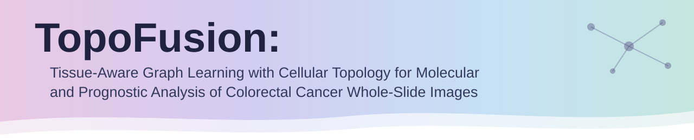
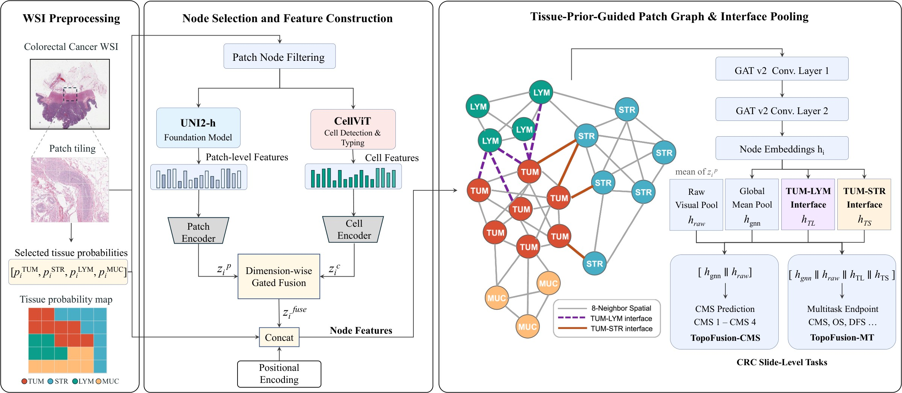
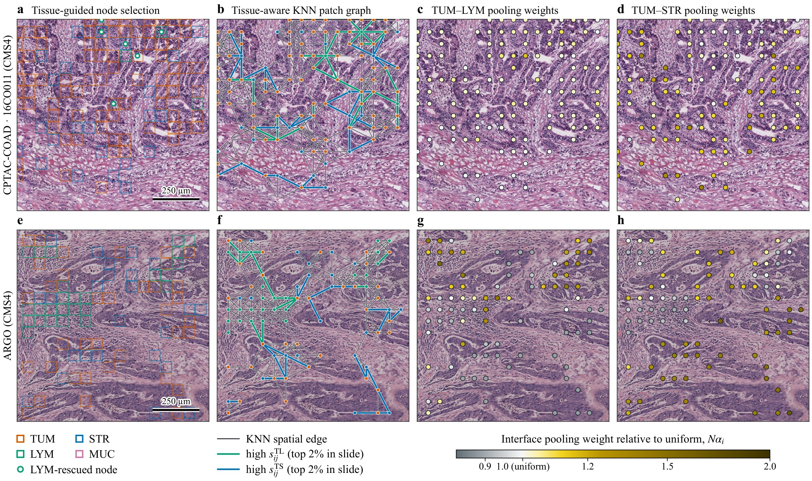

<div align="center">



<p>
  <a href="https://www3.cs.stonybrook.edu/~bibm2026/"></a>
  <a href="https://github.com/YuanyaoKevin2002/TopoFusion/commits/main"></a>
  <a href="#installation"></a>
  <a href="https://pytorch-geometric.readthedocs.io/"></a>
  <a href="LICENSE"></a>
</p>

</div>

> [!NOTE]
> **News** — TopoFusion has been accepted to **IEEE BIBM 2026** (Dallas, TX, USA). Code is released for non-commercial research use.

---

<p align="center">
  
</p>

**TopoFusion** represents each colorectal cancer (CRC) H&E whole-slide image as a directed, tissue-aware patch graph. Tissue probabilities drive four parts of the model: node filtering, tissue-interaction edge attributes, node features and interface-aware slide pooling. CellViT-derived cellular composition and topology descriptors are fused with UNI2-h patch morphology through dimension-wise gating.

## Highlights

| Component | What it does | Paper |
|---|---|---|
| **Dual-threshold node filtering** | Keeps a patch if `p_TUM + p_STR + p_LYM + p_MUC > 0.5` or `p_LYM > 0.05`, which retains sparse lymphocyte-rich patches. High-purity patches are capped at 3000 per dominant class. | Eq. (1) |
| **Tissue-interaction edges** | Spatial KNN (`k = 8`, cutoff 300) with 6-d attributes `[Δx, Δy, d̃, s_TL, s_TS, s_SL]`; disconnected components are bridged. | Eq. (2) |
| **Gated cell–patch fusion** | UNI2-h (1536-d → 128) and 12-d CellViT descriptors (5 cell-type counts + 7 topology features → 128) fused by a dimension-wise sigmoid gate, with modality dropout during training. | Eq. (3) |
| **Edge-aware GATv2 encoder** | Two GATv2Conv layers (2 heads × 128) over 164-d nodes `[z_fuse ‖ PE(q) ‖ p]` with 16-d edge embeddings. | §III-D |
| **Interface pooling** | Graph-wise softmax over tumor–lymphocyte and tumor–stroma interface scores gives `h_TL` and `h_TS`. | Eq. (4) |
| **Two instances** | **TopoFusion-CMS** uses the `[h_gnn ‖ h_raw]` readout (384-d). **TopoFusion-MT** uses `[h_gnn ‖ h_raw ‖ h_TL ‖ h_TS]` (896-d) shared by auxiliary classification heads and OS/DFS Cox heads. | §III-E, Eq. (5) |

<p align="center">
  
  <br><em>Retained nodes, tissue-interaction edges and interface pooling weights on a CPTAC-COAD region (top) and an ARGO region (bottom) (Fig. 2 of the paper).</em>
</p>

## Repository Structure

```text
TopoFusion/
├── src/topofusion_v3/
│   ├── graph_building.py           # tissue filtering, KNN edges, edge attributes, component bridging
│   ├── cell_features.py            # CellViT → 12-d cellular composition / topology descriptors
│   ├── build_graph_cache.py        # per-slide graph cache
│   ├── build_cell_feature_cache.py # per-slide cell-descriptor cache
│   ├── model.py                    # gated fusion, edge-aware GATv2, raw / interface pooling
│   ├── multitask/                  # TopoFusion-CMS & TopoFusion-MT training, losses, metrics, composite score
│   ├── baselines/                  # baseline training under the CMS-only and multitask protocols
│   └── gnncrc_baselines/           # MeanPool, ABMIL, CLAM, DSMIL, TransMIL, Patch-GCN, HEAT, HACT-Net
├── configs/
│   ├── topofusion_cms.yaml         # TopoFusion-CMS (final)
│   ├── topofusion_mt.yaml          # TopoFusion-MT  (final)
│   └── ablations/                  # single-switch ablation configs
├── docs/example_data_format.md     # expected manifest / H5 schema
└── examples/                       # example commands
```

## Installation

```bash
git clone https://github.com/YuanyaoKevin2002/TopoFusion.git
cd TopoFusion
conda env create -f environment.yaml
conda activate topofusion
# Install PyG companion packages that match your CUDA / PyTorch build if needed.
export PYTHONPATH="$(pwd)/src:${PYTHONPATH}"
```

Upstream feature extractors are not bundled. Install [UNI](https://github.com/mahmoodlab/UNI) (UNI2-h checkpoint, patch morphology) and [CellViT](https://github.com/TIO-IKIM/CellViT) (cell segmentation) from their official releases.

## Data Preparation

Each slide needs one H5 file with UNI2-h patch features, patch coordinates and tissue probabilities, plus optional CellViT-derived cell descriptors. A manifest CSV lists slides, patient IDs, cohort and labels. See [`docs/example_data_format.md`](docs/example_data_format.md) for the full schema. The tissue order used by TopoFusion is `[TUM, STR, LYM, MUC]`.

## Usage

| Model / experiment | Config |
|---|---|
| **TopoFusion-CMS** (CMS-only protocol, Table II) | [`configs/topofusion_cms.yaml`](configs/topofusion_cms.yaml) |
| **TopoFusion-MT** (multitask protocol, Table III) | [`configs/topofusion_mt.yaml`](configs/topofusion_mt.yaml) |
| CMS-only ablations (Table IV) | `configs/ablations/cms_wo_{cell_descriptors,raw_visual_pool,tissue_edge_attr}.yaml` |
| Multitask ablations (Table V) | `configs/ablations/mt_wo_{interface_pooling,cell_descriptors,raw_visual_pool,tissue_edge_attr}.yaml` |

Each ablation config is identical to its parent config except for a single switch (`zero_cell_descriptors`, `zero_edge_tissue_interactions`, `slide_pool_include_raw` or `slide_pool_include_interface`).

```bash
# 1) Build graph and cell-descriptor caches
python -m topofusion_v3.build_cell_feature_cache --config configs/topofusion_mt.yaml
python -m topofusion_v3.build_graph_cache        --config configs/topofusion_mt.yaml

# 2) TopoFusion-CMS: CMS-only training, checkpoint selected by validation CMS macro-AUC
python -m topofusion_v3.multitask.train_cms_single --config configs/topofusion_cms.yaml

# 3) TopoFusion-MT: multitask training, checkpoint selected by validation composite score
python -m topofusion_v3.multitask.train_multitask  --config configs/topofusion_mt.yaml --epochs 80
```

Training settings used in the paper: AdamW, learning rate 1e-4, weight decay 5e-4, batch size 2 with 4-step gradient accumulation (effective batch size 8), and gradient clipping at 1.0. Multitask task weights are 0.8 for CMS, MSI and CIN and 1.5 for pN, OS and DFS; MSI, CIN and pN serve only as additional training signals and are not evaluated. CMS entropy regularization uses λ = 0.01.

## Data Availability

- **TCGA-COAD/READ** (development) is available from the [GDC Data Portal](https://portal.gdc.cancer.gov/).
- **CPTAC-COAD** (external) is available from [The Cancer Imaging Archive](https://www.cancerimagingarchive.net/collection/cptac-coad/).
- **ARGO** (external, n = 2,278) is an institutional cohort. Access is available upon reasonable request to the corresponding author, subject to institutional approval.

This repository contains code only. It does not include slides, features, labels, patient or slide identifiers, or trained weights.

## Citation

```bibtex
@inproceedings{cheng2026topofusion,
  title     = {TopoFusion: Tissue-Aware Graph Learning with Cellular Topology for Molecular and Prognostic Analysis of Colorectal Cancer Whole-Slide Images},
  author    = {Cheng, Yuanyao and Nie, Xiuping and Xu, Chenchen and He, Lingli and Jiang, Hang and Xu, Jia and Gao, Feng and Wang, Xin},
  booktitle = {Proceedings of the IEEE International Conference on Bioinformatics and Biomedicine (BIBM)},
  year      = {2026}
}
```

## License

This code is released for **non-commercial academic research use only**. See [`LICENSE`](LICENSE). Commercial use requires prior written permission from the authors.

## Acknowledgements

This work builds on [UNI](https://github.com/mahmoodlab/UNI), [CellViT](https://github.com/TIO-IKIM/CellViT), [PyTorch Geometric](https://github.com/pyg-team/pytorch_geometric) and the public baseline implementations of [CLAM](https://github.com/mahmoodlab/CLAM), [DSMIL](https://github.com/binli123/dsmil-wsi), [TransMIL](https://github.com/szc19990412/TransMIL), [Patch-GCN](https://github.com/mahmoodlab/Patch-GCN), HEAT and HACT-Net.

For questions, please contact Yuanyao Cheng (yycheng@surgery.cuhk.edu.hk) or open an issue.
